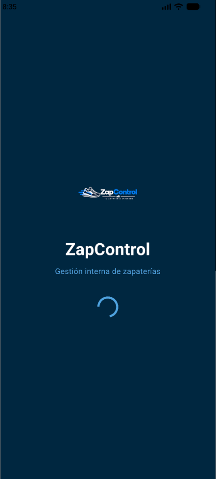
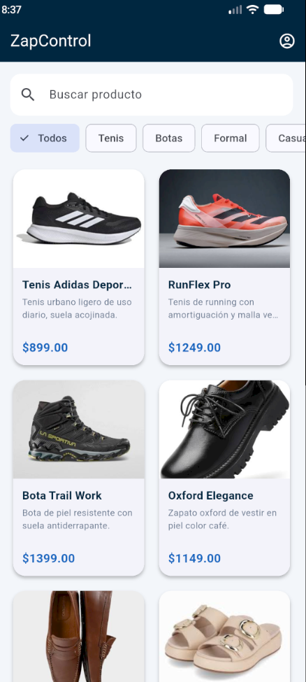
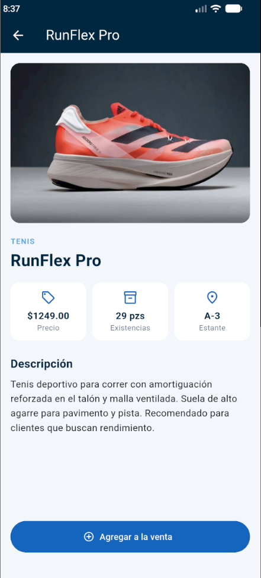

# zap_controller_1_0

A new Flutter project.

## Pantalla de bienvenida

## Pantalla principal

## Pantalla de detalles

# Preguntas 
1.- ¿Qué propiedad del widget Scaffold se utiliza comúnmente para colocar una barra de
navegación superior que contiene un título y botones de acción?

## appBar

2.- ¿Cuál es el propósito principal de la propiedad elevation en el widget Card de Flutter?

 ## Controla la sombra de la tarjeta. En tarjeta_producto.dart usamos Card(elevation: 3, ...), y por eso cada producto se ve "levantado" del fondo gris claro. Con elevation: 0 quedaría plana, y con un valor mayor la sombra sería más fuerte.

3.- ¿Qué widget utilizarías para recortar de forma limpia los bordes de una imagen
rectangular (como Image.asset) de manera que adquiera esquinas redondeadas exactas?

## ClipRRect. En pantalla_detalle.dart envuelve la foto del zapato:

4.-  Si deseas utilizar imágenes locales (Image.asset) en tu interfaz, ¿qué paso previo y
obligatorio debes realizar en la estructura del proyecto para que la imagen se cargue sin
errores?

## Meter las imágenes en assets/images/ y declarar esa carpeta en pubspec.yaml

5.- ¿Cómo puedes modificar de manera directa el tamaño y el color de un widget Icon?

## Con sus propiedades size y color. En el método _dato de pantalla_detalle.dart:

6.- ¿Cuál es la diferencia clave entre usar InkWell y GestureDetector para gestionar
toques en Flutter?

## En el proyecto usamos InkWell en TarjetaProducto InkWell muestra la onda de Material al tocar la tarjeta, así el empleado ve que sí se presionó. Un GestureDetector habría abierto el detalle igual, pero sin ningún efecto visual. Por eso, para tarjetas y botones se prefiere InkWell. GestureDetector se usa cuando necesitas gestos extra (arrastrar, doble toque) o no quieres efecto.

7.- En un widget Row, ¿qué propiedad se encarga específicamente de alinear y distribuir
los widgets hijos a lo largo de su eje principal (el eje horizontal)? 

## mainAxisAlignment. En el proyecto la usamos en el splash, en una Column, donde el eje principal es el vertical. En un Row funciona igual pero en horizontal; por ejemplo, MainAxisAlignment.spaceBetween separa a los hijos hacia los extremos. En el Row del detalle no la necesitamos, porque ahí repartimos el ancho con Expanded.

8.- Si dentro de un Row añades textos muy largos que provocan un error de
desbordamiento gráfico horizontal (RenderFlex overflow), ¿qué widget puedes utilizar
para obligar al texto a ajustarse y ocupar únicamente el espacio libre restante?

## Expanded. En el detalle, el Row de los tres datos (precio, existencias, estante) tiene cada bloque dentro de un Expanded. Así cada bloque ocupa solo su parte del ancho y el texto no se sale de la pantalla. Si el texto fuera aún más largo, se le agrega maxLines y overflow: TextOverflow.ellipsis, como hicimos con el nombre del producto en la tarjeta.

9.- ¿Cuál es la forma más común y directa de enviar datos (por ejemplo, el objeto con la
información detallada) al navegar hacia una nueva pantalla utilizando Navigator?

## Por el constructor de la pantalla destino. En TarjetaProducto Y en PantallaDetalle se recibe así 
## final Producto producto;
## const PantallaDetalle({super.key, required this.producto});
## Con eso el detalle muestra la información del producto que se tocó.

10.- ¿Cómo se puede obtener de forma asíncrona el valor o resultado que una segunda
pantalla devuelve al cerrarse mediante una llamada a Navigator.pop(context, resultado)?

## Con await sobre el Navigator.push, que devuelve un Future. En la versión final del proyecto no devolvemos nada (el botón “Agregar a la venta” solo muestra un SnackBar), así que esto no aparece en el código.

